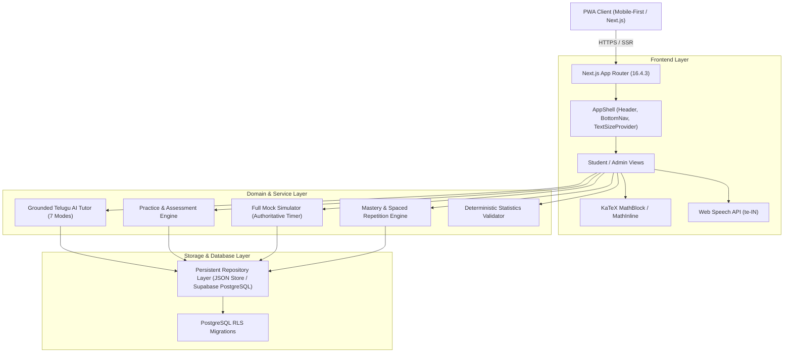

# MISSION MPSO — Architecture & System Design

## 1. Architectural Philosophy
The core philosophy of MISSION MPSO is:
> **"One Student. One Mission. One Intelligent Learning Companion."**

The platform is designed around 5 fundamental learning questions:
1. **What should the student learn today?** (Adaptive Daily Study Planner)
2. **What does the student already understand?** (Evidence-based Mastery Engine)
3. **Which topics require additional attention?** (Topic Diagnostic & Performance Analytics)
4. **What knowledge is likely to be forgotten without revision?** (Spaced Repetition Queue)
5. **How can the student improve exam performance through targeted practice?** (Topic Quizzes & 150-Question Timed Mock Simulator)

---

## 2. High-Level Architecture Diagram

---

## 3. Module Boundaries

### A. Authentication & Session Module (`src/lib/auth/`)
- Supports two explicit roles: `student` and `admin`.
- Enforces server-side authorization through `requireAuth()` and `requireAdmin()`.
- Client components cannot bypass access control.

### B. Curriculum Engine (`src/lib/curriculum/`)
- Authoritative mapping of TGPSC Notification 07/G/ES/2026 Annexure-II:
  - **Paper I:** 13 General Studies topics (Telangana History, Movement, Culture, Policies, Indian Economy, Geography, Polity, Science, Reasoning, Basic English).
  - **Paper II:** 8 Degree Statistics units (Intro, Central Tendency & Dispersion, Probability & Bayes, Distributions, Correlation & Regression, Time Series & Index Numbers, Sampling, Computer Basics).
- Immutable syllabus references prevent drift from official notification wording.

### C. Deterministic Numerical Validator (`src/lib/numerical/`)
- Mathematical calculations must never rely on probabilistic LLM outputs.
- `StatisticsValidator` provides deterministic calculation of:
  - Central Tendency: Mean, Median, Empirical Mode
  - Dispersion: Variance, Standard Deviation, Coefficient of Variation
  - Probability: Addition theorem, Combinations \(nCr\), Bayes' theorem
  - Distributions: Binomial, Poisson probabilities
  - Association: Karl Pearson coefficient \(r\), Regression slope \(b_{yx}\), \(b_{xy}\)
  - Index Numbers: Laspeyres, Paasche, Fisher's Ideal Index
- Validates question options with configurable tolerance margins.

### D. Grounded Telugu AI Tutor (`src/lib/ai/`)
- Retrieval-Augmented Generation (RAG) context injection from verified curriculum lessons.
- 7 pedagogical modes:
  1. `teach_me` (బోధించు)
  2. `explain_simply` (సరళంగా వివరించు)
  3. `solve_together` (కలిసి సాధిద్దాం)
  4. `give_another_example` (మరో ఉదాహరణ)
  5. `test_understanding` (అవగాహన పరీక్షించు)
  6. `explain_mistake` (నా తప్పును వివరించు)
  7. `quick_revision` (సత్వర పునశ్చరణ)
- Operates 100% offline using a built-in pedagogical generation engine, with optional live LLM passthrough (Gemini/OpenAI) when API keys are configured.

### E. Adaptive Learning & Mastery Engine (`src/lib/adaptive/`)
- Strict evidence thresholds: a student requires at least 5 independent question attempts with >= 85% accuracy to reach "Strong" mastery.
- Spaced Repetition engine automatically schedules reviews at 1, 3, 7, 14, and 30-day intervals.
- Mistake Book preserves student answers, correct answers, and error classifications (conceptual, calculation, formula, reading error).

### F. Full-Length Mock Examination Simulator (`src/components/mock/`)
- Matches official TGPSC specifications: 150 questions, 150 minutes, 150 marks.
- Server-authoritative countdown timer prevents browser-refresh tampering.
- OMR-style palette tracks Answered, Unanswered, Marked for Review, Answered & Marked, and Not Visited questions.
