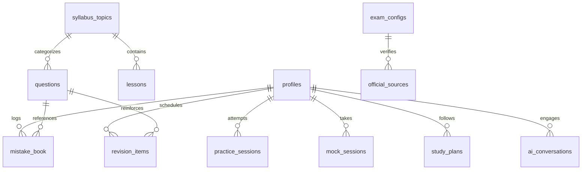

# MISSION MPSO — Database Schema & Data Models

## 1. Schema Overview
MISSION MPSO uses PostgreSQL with Row Level Security (RLS), with ready-to-run migrations located in `supabase/migrations/20261101_init_mission_mpso.sql`.

During local development and offline environments, the repository automatically falls back to an atomic persistent file store (`data/mission_mpso_db.json`), ensuring seamless execution without external database setup.

---

## 2. Entity Relationship Diagram

---

## 3. Core Tables Reference

### 1. `profiles`
Stores student and administrator identities, learning preferences, and daily study targets.
- `id` (UUID, Primary Key)
- `email` (TEXT, Unique)
- `role` (`student` | `admin`)
- `display_name` (TEXT)
- `language` (`te` | `en`)
- `education_background` (TEXT)
- `statistics_familiarity` (`beginner` | `intermediate` | `comfortable`)
- `daily_study_minutes` (INTEGER, Default: 120)
- `preferred_study_window` (`morning` | `afternoon` | `evening` | `flexible`)
- `target_exam` (TEXT)
- `enable_voice` (BOOLEAN)
- `text_size` (`normal` | `large` | `extra-large`)
- `has_completed_onboarding` (BOOLEAN)
- `has_completed_diagnostic` (BOOLEAN)

### 2. `exam_configs`
Source of truth for TGPSC examination parameters.
- `id` (UUID, Primary Key)
- `notification_number` (TEXT, e.g., "07/G/ES/2026")
- `notification_date` (DATE, e.g., "2026-10-28")
- `recruitment_name_te` / `recruitment_name_en` (TEXT)
- `authority` (TEXT, "TGPSC")
- `online_application_start` / `online_application_end` (TIMESTAMPTZ)
- `tentative_exam_month` (TEXT, "January 2027")
- `confirmed_exam_date` (DATE, Nullable)
- `exam_mode` (`UNKNOWN` | `OMR` | `CBRT`)
- `total_questions` (INTEGER, 300)
- `total_marks` (INTEGER, 300)
- `negative_marking_policy` (`unconfirmed` | `none` | `one_fourth` | `one_third`)
- `negative_marking_penalty` (NUMERIC)
- `negative_marking_note_te` (TEXT)
- `official_source_url` (TEXT)
- `verification_status` (`verified` | `pending_official_announcement`)
- `config_version` (TEXT)

### 3. `syllabus_topics`
Authoritative curriculum hierarchy covering Paper I (13 items) and Paper II (8 units).
- `id` (TEXT, Primary Key)
- `paper_id` (`paper_1` | `paper_2`)
- `unit_number` (INTEGER)
- `unit_title_te` / `unit_title_en` (TEXT)
- `title_te` / `title_en` (TEXT)
- `official_wording_en` (TEXT)
- `subtopics` (JSONB)
- `difficulty` (`easy` | `medium` | `hard`)
- `estimated_study_hours` (INTEGER)
- `weightage_estimated_questions` (INTEGER)
- `is_verified_official` (BOOLEAN)

### 4. `questions`
Question bank with bilingual presentation, LaTeX formatting, and numerical validation data.
- `id` (TEXT, Primary Key)
- `paper_id` (`paper_1` | `paper_2`)
- `topic_id` (TEXT, Foreign Key)
- `question_text_te` / `question_text_en` (TEXT)
- `question_math_latex` (TEXT)
- `options` (JSONB: Array of `{ id, textTe, textEn, mathLatex }`)
- `correct_option_id` (`A` | `B` | `C` | `D`)
- `explanation_te` / `explanation_en` (TEXT)
- `relevant_formula_latex` (TEXT)
- `difficulty` (`easy` | `medium` | `hard`)
- `source_type` (`official_pyq` | `standard_degree_textbook` | `tgpsc_standard_model` | `reviewed_ai_generated` | `current_affairs_editorial`)
- `numerical_metadata` (JSONB: `{ isNumerical, formulaUsed, calculatedValue, tolerance, independentValidationPassed }`)
- `validation_status` (`draft` | `validation_pending` | `validation_passed` | `review_required` | `approved` | `rejected` | `archived`)

### 5. `mock_sessions`
Full-length mock sessions with server-authoritative timestamps.
- `id` (UUID, Primary Key)
- `user_id` (UUID, Foreign Key)
- `mock_type` (`paper_1_full` | `paper_2_full` | `combined_full` | `mini_mock`)
- `total_questions` (INTEGER)
- `total_duration_minutes` (INTEGER)
- `started_at` (TIMESTAMPTZ)
- `expires_at` (TIMESTAMPTZ)
- `submitted_at` (TIMESTAMPTZ)
- `status` (`in_progress` | `submitted` | `auto_submitted_expired`)
- `question_states` (JSONB: Dictionary of `{ questionId, selectedOptionId, status, timeSpentSeconds }`)

### 6. `mistake_book`
Persistent student error ledger.
- `id` (UUID, Primary Key)
- `user_id` (UUID, Foreign Key)
- `question_id` (TEXT, Foreign Key)
- `student_answer` (TEXT)
- `mistake_category` (`concept_misunderstanding` | `formula_confusion` | `calculation_mistake` | `question_reading_mistake` | `time_management` | `unclassified`)
- `review_count` (INTEGER)
- `is_resolved` (BOOLEAN)
- `bookmarked` (BOOLEAN)
- `ai_explanation_te` (TEXT)

### 7. `revision_items`
Spaced repetition schedule (Intervals: 1, 3, 7, 14, 30 days).
- `id` (UUID, Primary Key)
- `user_id` (UUID, Foreign Key)
- `reference_id` (TEXT)
- `topic_id` (TEXT)
- `interval_days` (INTEGER)
- `repetition_stage` (INTEGER)
- `due_date` (DATE)
- `is_completed` (BOOLEAN)

### 8. `study_plans`
Personalized daily study schedules.
- `id` (UUID, Primary Key)
- `user_id` (UUID, Foreign Key)
- `plan_date` (DATE)
- `tasks` (JSONB)
- `total_target_minutes` (INTEGER)
- `completed_minutes` (INTEGER)
