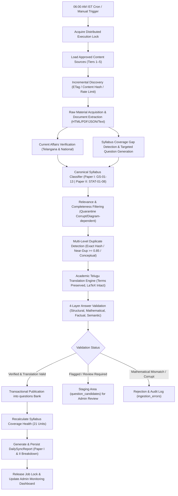

# MISSION MPSO — Question Intelligence & Content Ingestion Engine Architecture
**Target Examination:** TGPSC Mandal Planning & Statistical Officer / Assistant Statistical Officer (Notification 07/G/ES/2026)  
**Exam Target:** January 2027 (tentative)  
**Core Languages:** Telugu (Primary academic vehicle) & English  
**Execution Cycle:** 06:00 AM Asia/Kolkata daily automated synchronization + manual trigger  

---

## 1. System Vision & Architecture Overview

The **Autonomous Question Intelligence & Ingestion System** continuously discovers, acquires, classifies, verifies, translates, and synchronizes syllabus-aligned practice material into the MISSION MPSO platform.

Rather than acting as an indiscriminate web scraper or toy script, the engine is built on **strict content compliance**, **deterministic mathematical ground truth verification**, **canonical syllabus hierarchy mapping**, and **transparent provenance tracing**.

---

## 2. Architectural Pipeline Stages

### Stage 1: Distributed Job Scheduler & Mutex Locking
- Scheduled daily at **06:00 AM IST** (`Asia/Kolkata`).
- Supported by deployment-native triggers, backend worker processes, and administrative on-demand endpoints (`/api/pipeline/sync`).
- Enforces an in-memory / persistent distributed lock to prevent concurrent or overlapping executions.
- Idempotent: If no new material exists on a given day, the system reports 0 new questions rather than fabricating filler content.

### Stage 2: Ethical & Incremental Content Discovery
- Governed by `SourceRegistryService` and `ContentCrawlerService`.
- Strictly checks `robots.txt`, domain-specific rate limits, and explicit licensing metadata.
- Employs HTTP `ETag`, `Last-Modified`, and SHA-256 content hashes to detect genuine modifications before downloading or extracting files.
- Disallowed or paywalled domains are never bypassed.

### Stage 3: Document Extraction & LaTeX Normalization
- Supports HTML, PDF text streams, structured JSON, CSV, Markdown, and plain text.
- Extracts stems, options (A, B, C, D or 1, 2, 3, 4), and answer keys.
- Normalizes statistical equations into standard KaTeX notation (e.g., \(\sigma^2\), \(\mu\), \(\lambda\), \(\text{Var}(X)\), \(\text{E}(X)\), \(\binom{n}{k}\)).
- Reconciles preliminary vs. final vs. revised final answer keys; official cancellations are quarantined with explicit explanations.

### Stage 4: AI Canonical Syllabus Classification
- Maps questions strictly against the TGPSC Notification 07/G/ES/2026 curriculum:
  - **Paper I:** 13 General Studies topics (`p1_current_affairs` to `p1_basic_english`).
  - **Paper II:** 8 Degree-Level Statistics units (`p2_intro_statistics` to `p2_basics_of_computers`).
- Quarantines items outside the syllabus or missing required options/diagrams.

### Stage 5: Multi-Level Deduplication
- **Level 1 (Exact):** SHA-256 hash of normalized text (lowercase, punctuation-stripped, Unicode normalized).
- **Level 2 (Near-Duplicate):** Token Jaccard and containment similarity \(\ge 0.85\).
- **Level 3 (Conceptual Variant):** Identifies identical formulas with differing numeric parameters, preserving them as spaced repetition variations rather than redundant noise.

### Stage 6: Telugu Academic Translation & Terminology Enforcement
- Translates content into natural academic Telugu.
- Enforces retention of English technical terms in parentheses (e.g., `అంకగణిత సగటు (Arithmetic Mean)`, `ప్రామాణిక విచలనం (Standard Deviation)`).
- Validates that numeric values, units, negation semantics, and LaTeX formulas remain identical across languages.

### Stage 7: Deterministic Multi-Layer Validation
- **Layer 1 (Structural):** 4 non-empty distinct options, valid key (A/B/C/D), explanation present.
- **Layer 2 (Mathematical):** Independent recalculation of formulas (Mean, Median, Mode, Variance, SD, CV, Binomial, Poisson, Correlation, Regression, Binary/Hex).
- **Layer 3 (Factual):** Verification of dates, Telangana government policies, and official statistics.
- **Layer 4 (Semantic):** Detection of ambiguous wording or trivial giveaways.

### Stage 8: Transactional Publication & Practice Engine Sync
- Validated candidates are inserted directly into the core `questions` table.
- Immediately available to students through existing practice quizzes (`/practice`), full mock tests (`/mocks`), and the adaptive mastery engine.
- Recalculates unit-by-unit coverage health.
- Persists audit reports in `daily_sync_reports` and updates the Administrator Portal.
