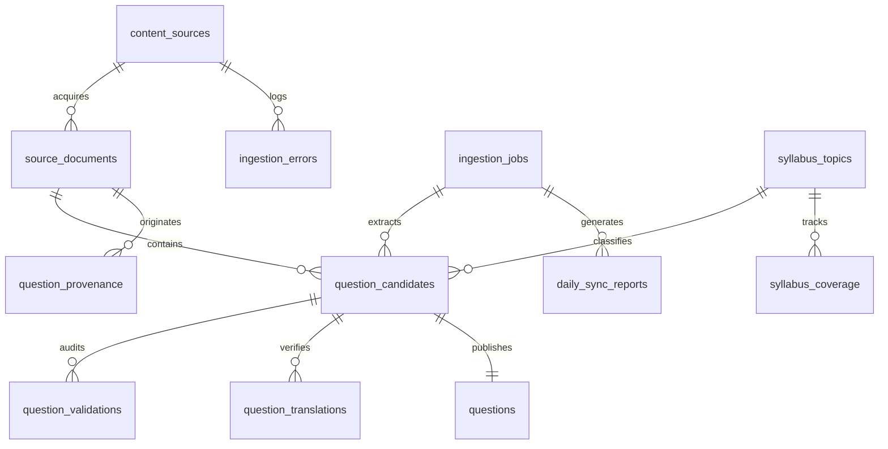

# MISSION MPSO — Database Schema & Data Models (Question Intelligence)
**Migration File:** `supabase/migrations/20261102_question_intelligence.sql`  
**Persistent JSON Fallback:** `data/mission_mpso_db.json` via `src/lib/db/index.ts`  
**Notification:** TGPSC 07/G/ES/2026

---

## 1. Schema Architecture & Entity Relationship

---

## 2. Table Specifications

### 1. `content_sources`
Catalog of compliant sources with trust tiers and crawling rules.
- `id` (TEXT, PK): e.g. `src_tgpsc_official`
- `name` (TEXT): Display name
- `url` (TEXT): Canonical URL
- `source_category` (TEXT): `official_commission` | `state_government` | `academic_oer` | `related_government_exam` | `third_party_reference`
- `trust_tier` (INTEGER): `1` (Official) to `5` (Reference)
- `license_type` (TEXT): e.g. `official_tgpsc_public_notice`, `government_open_data`, `creative_commons_by_sa`
- `reuse_permissions` (TEXT): `full_question_reproduction` | `metadata_and_citation_only` | `original_derivation_permitted`
- `crawling_allowed` (BOOLEAN): Respects robots.txt
- `scan_frequency` (TEXT): `daily` | `weekly` | `manual`
- `last_checked_at` (TIMESTAMPTZ)
- `etag` / `content_hash` (TEXT): For incremental change detection
- `is_active` (BOOLEAN)

### 2. `ingestion_jobs`
Ledger of every background and manual sync execution.
- `id` (TEXT, PK): e.g. `job_sync_2026-11-02_1793610253258`
- `trigger_type` (TEXT): `scheduled_cron` | `manual_admin` | `coverage_gap_fill`
- `started_at` / `finished_at` (TIMESTAMPTZ)
- `status` (TEXT): `pending` | `running` | `completed` | `failed`
- `sources_checked`, `documents_discovered`, `candidates_extracted` (INTEGER)
- `verified_count`, `published_count`, `review_required_count`, `rejected_count`, `duplicates_detected` (INTEGER)
- `errors` (JSONB)
- `report_summary` (TEXT)

### 3. `source_documents`
Discovered documents (HTML, PDF, JSON, etc.) with content hashes.
- `id` (TEXT, PK)
- `source_id` (TEXT, FK -> `content_sources.id`)
- `original_url` (TEXT)
- `title` (TEXT)
- `retrieved_at` (TIMESTAMPTZ)
- `content_hash` (TEXT, SHA-256)
- `file_type` (TEXT): `pdf` | `html` | `json` | `csv` | `markdown` | `text`
- `license_status` (TEXT)
- `extraction_status` (TEXT): `pending` | `extracted` | `failed` | `quarantined`
- `document_version` (INTEGER)

### 4. `question_candidates`
Staging area for discovered, generated, or extracted MCQs.
- `id` (TEXT, PK)
- `job_id` (TEXT, FK -> `ingestion_jobs.id`)
- `paper_id` (TEXT): `paper_1` | `paper_2`
- `topic_id` (TEXT, FK -> `syllabus_topics.id`)
- `subtopic_id` (TEXT)
- `question_text_te` / `question_text_en` (TEXT)
- `question_math_latex` (TEXT)
- `options` (JSONB: Array of `{ id, textTe, textEn, mathLatex }`)
- `correct_option_id` (TEXT): `A` | `B` | `C` | `D`
- `explanation_te` / `explanation_en` (TEXT)
- `relevant_formula_latex` (TEXT)
- `difficulty` (TEXT): `easy` | `medium` | `hard`
- `source_category` (TEXT)
- `authenticity` (JSONB: `{ isAuthenticPyq, examinationName, examAuthority, examYear, bookletSeries, originalQuestionNumber }`)
- `numerical_metadata` (JSONB: `{ isNumerical, formulaUsed, calculatedValue, tolerance, independentValidationPassed }`)
- `validation_status` (TEXT): `discovered` | `extracted` | `classified` | `validation_pending` | `validation_failed` | `review_required` | `verified` | `published` | `rejected`
- `duplicate_of_question_id` (TEXT)

### 5. `question_provenance`
Full attribution lineage for every question.
- `id` (TEXT, PK)
- `question_id` (TEXT)
- `source_document_id` (TEXT)
- `source_url` (TEXT)
- `source_name` (TEXT)
- `source_tier` (INTEGER)
- `license_type` (TEXT)
- `attribution_text` (TEXT)
- `imported_at` (TIMESTAMPTZ)

### 6. `question_validations`
Layer-by-layer audit trail.
- `id` (TEXT, PK)
- `question_id` (TEXT)
- `layer` (TEXT): `structural` | `mathematical` | `factual` | `semantic`
- `passed` (BOOLEAN)
- `validator_name` (TEXT)
- `details` (JSONB)
- `error_message` (TEXT)

### 7. `question_translations`
Academic Telugu translation verification records.
- `id` (TEXT, PK)
- `question_id` (TEXT)
- `language` (TEXT): `te`
- `translated_text` (TEXT)
- `translated_explanation` (TEXT)
- `terms_preserved` (JSONB)
- `mathematical_notation_intact` (BOOLEAN)
- `numeric_values_preserved` (BOOLEAN)
- `validation_status` (TEXT): `verified` | `review_needed` | `rejected`

### 8. `syllabus_coverage`
Topic health monitoring across all 21 units.
- `topic_id` (TEXT, PK)
- `paper_id` (TEXT): `paper_1` | `paper_2`
- `total_published` (INTEGER)
- `authentic_pyq_count` (INTEGER)
- `original_practice_count` (INTEGER)
- `easy_count`, `medium_count`, `hard_count` (INTEGER)
- `numerical_count` (INTEGER)
- `coverage_score` (NUMERIC): 0 to 100%
- `coverage_health` (TEXT): `good` | `adequate` | `needs_questions` | `critical_gap`

### 9. `daily_sync_reports`
Permanent audit reports generated after each daily cycle.
- `id` (TEXT, PK)
- `report_date` (DATE)
- `job_id` (TEXT)
- `sources_checked_count`, `published_count`, `review_required_count`, `duplicates_detected_count` (INTEGER)
- `paper1_new_count_by_topic` (JSONB)
- `paper2_new_count_by_topic` (JSONB)
- `source_changes` (JSONB)
- `validation_warnings` (JSONB)
- `actions_required` (JSONB)
