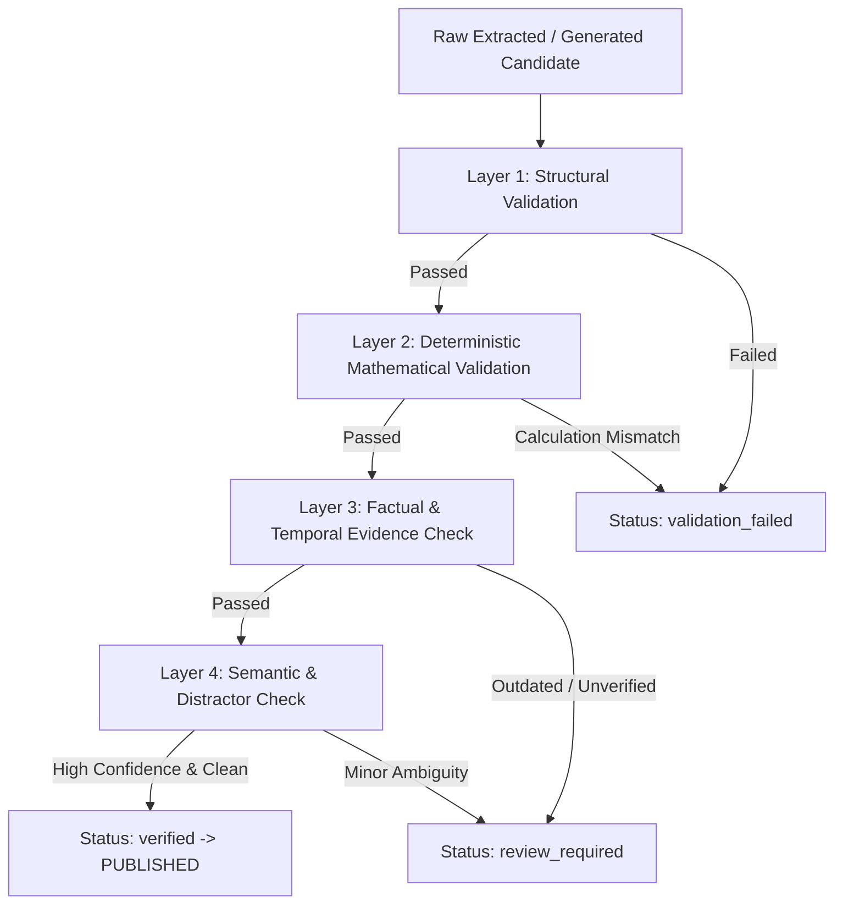

# MISSION MPSO — Multi-Layer Question Validation Engine
**Target Examination:** TGPSC MPSO / ASO (Notification 07/G/ES/2026)  
**Standard:** 100% Deterministic Mathematical Accuracy & Strict Factual Verification

---

## 1. Validation Architecture & Quality Mandate

In a high-stakes government recruitment examination (TGPSC MPSO / ASO), incorrect answers or inaccurate mathematical formulas mislead students and destroy confidence.

MISSION MPSO enforces an automated **4-Layer Verification Protocol** that executes before any question is permitted into the live question bank:



---

## 2. Layer-by-Layer Verification Specifications

### Layer 1: Structural Schema Validation (`StructuralSchemaValidator`)
- **Question Stem:** Non-empty string, minimum 10 characters in English and Telugu.
- **Option Count:** Exactly 4 distinct non-empty options.
- **Option Uniqueness:** Verifies that no two options have identical text (rejects duplicate choices).
- **Correct Option Key:** Must be one of `['A', 'B', 'C', 'D']`.
- **Explanation:** Non-empty step-by-step solution provided in Telugu (with optional English).
- **Syllabus Mapping:** Mandatory mapping to an official syllabus unit (GS-01 to GS-13 or STAT-01 to STAT-08).

### Layer 2: Deterministic Mathematical Validation (`DeterministicStatisticsValidator`)
Numerical Statistics questions (Paper II) cannot rely on an LLM to verify itself. The engine calculates mathematical ground truth using deterministic algorithms:

1. **Measures of Central Tendency:**
   - **Arithmetic Mean:** \(\bar{x} = \frac{\sum x_i}{N}\)
   - **Median:** Middle value of sorted observations.
   - **Empirical Mode:** \(\text{Mode} = 3(\text{Median}) - 2(\text{Mean})\)
2. **Measures of Dispersion:**
   - **Population Variance:** \(\sigma^2 = \frac{\sum (x_i - \bar{x})^2}{N}\)
   - **Sample Variance:** \(s^2 = \frac{\sum (x_i - \bar{x})^2}{N-1}\)
   - **Standard Deviation:** \(\sigma = \sqrt{\text{Variance}}\)
   - **Coefficient of Variation:** \(\text{CV} = \left(\frac{\sigma}{\bar{x}}\right) \times 100\)
   - **Quartile Deviation:** \(\text{QD} = \frac{Q_3 - Q_1}{2}\)
   - **Bowley's Skewness:** \(S_b = \frac{Q_3 + Q_1 - 2M}{Q_3 - Q_1}\)
   - **Karl Pearson's Skewness:** \(S_k = \frac{\text{Mean} - \text{Mode}}{\sigma}\)
3. **Probability & Distributions:**
   - **Binomial Distribution:** \(P(X = k) = \binom{n}{k} p^k (1-p)^{n-k}\), \(\text{Mean} = np\), \(\text{Var} = npq\)
   - **Poisson Distribution:** \(P(X = k) = \frac{\lambda^k e^{-\lambda}}{k!}\), \(\text{Mean} = \text{Variance} = \lambda\)
   - **Normal Distribution:** \(Z = \frac{X - \mu}{\sigma}\), Empirical 68–95–99.7% confidence regions.
4. **Correlation & Regression:**
   - **Regression Coefficients:** \(r = \pm\sqrt{b_{yx} \times b_{xy}}\)
   - **Regression Lines:** \((y - \bar{y}) = b_{yx}(x - \bar{x})\) and \((x - \bar{x}) = b_{xy}(y - \bar{y})\)
5. **Computer Fundamentals (STAT-08):**
   - Binary, Octal, Hexadecimal, and Decimal conversions.
   - Bitwise logic: `AND`, `OR`, `XOR`, `NOT`, and bit-shifts.

> [!IMPORTANT]
> If the independently calculated mathematical value deviates from the marked correct option by more than the tolerance threshold (\(\pm 0.05\)), the question is **immediately failed** with `validation_failed` status.

### Layer 3: Factual & Temporal Evidence Check (`FactualEvidenceValidator`)
- Applied to General Studies (Paper I) questions.
- Verifies that event dates precede or match publication dates.
- Flags outdated institutions or expired economic schemes (e.g., historical Planning Commission vs. NITI Aayog).
- Requires citation of official government department releases, Socio-Economic Outlook, or gazettes.

### Layer 4: Semantic & Distractor Quality Check (`SemanticDistractorValidator`)
- Checks for clarity and eliminates ambiguous phrasing.
- Verifies that distractors are plausible and mutually exclusive.
- Rejects questions with excessive trivial meta-options (e.g., multiple "All of the above" / "None of the above").

---

## 3. Publication State Machine

```
DISCOVERED ──> EXTRACTED ──> CLASSIFIED ──> VALIDATION_PENDING
                                                    │
                 ┌──────────────────────────────────┴──────────────────────────────────┐
                 ▼                                                                     ▼
       [VALIDATION_FAILED]                                                   [REVIEW_REQUIRED]
      (Hard math error / corrupt)                                       (Borderline / Translation flag)
                 │                                                                     │
                 ▼                                                                     ▼
             REJECTED                                                         Admin Review in CMS
                                                                                       │
                                                                   ┌───────────────────┴───────────────────┐
                                                                   ▼                                       ▼
                                                               REJECTED                                VERIFIED
                                                                                                           │
                                                                                                           ▼
                                                                                                       PUBLISHED
                                                                                            (Visible in Practice & Mocks)
```
